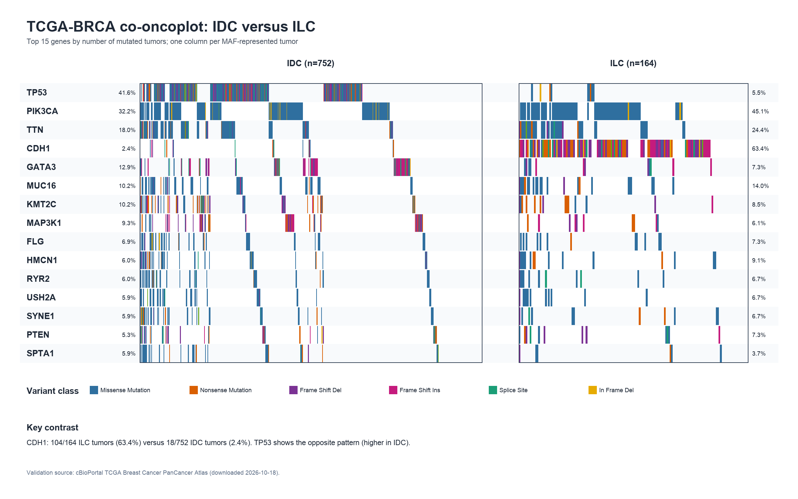
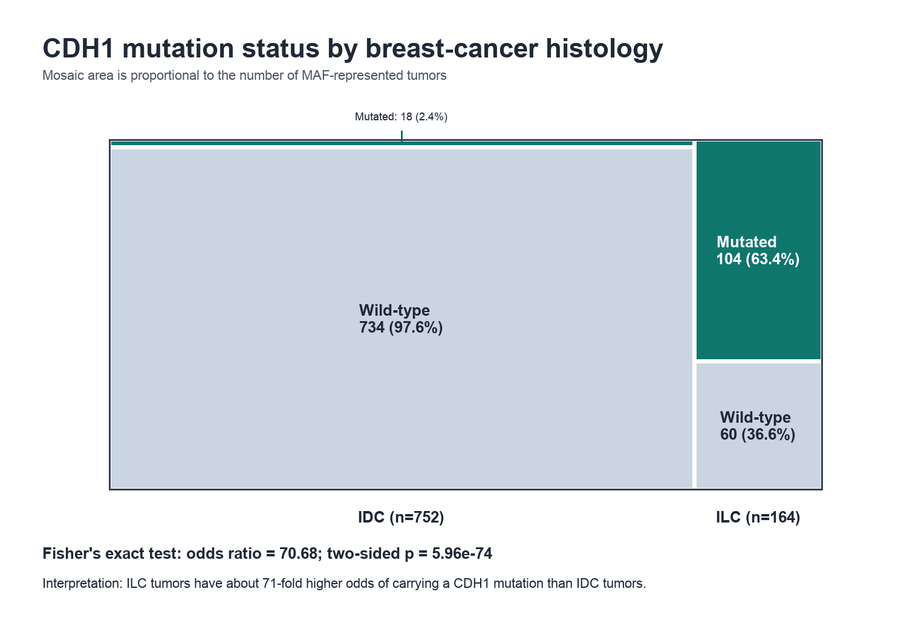
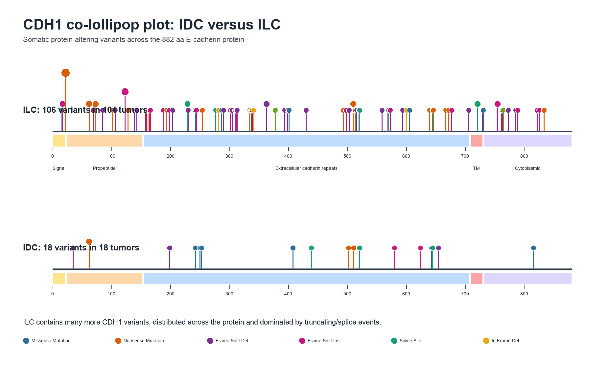
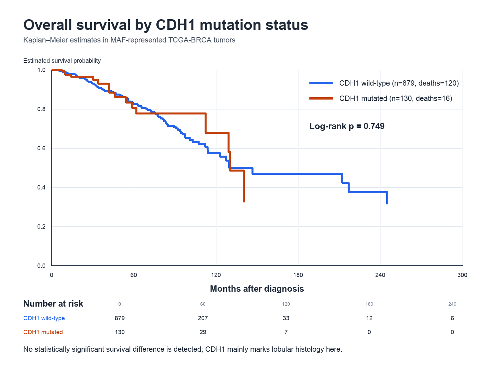

<!-- Student: Austin Lee -->
<!-- Human partners: none. This assignment was completed with AI assistance, as permitted for the course. -->

## Deliverables

- This completed R Notebook is stored in `week6_genomics/Introduction_to_MAF.Rmd`.
- Every figure is saved in `week6_genomics/figures/` with a descriptive name.
- The analysis uses TCGA Breast Invasive Carcinoma (TCGA-BRCA) clinical and masked somatic mutation data.
- All mutation-frequency, contingency-table, and survival analyses use the same cohort: patients represented in the nonsynonymous MAF data.

## Pre-assignment: packages, clinical data, and the MAF object

```{r setup, message=FALSE, warning=FALSE}
required_packages <- c("data.table", "maftools", "survival", "TCGAbiolinks")
missing_packages <- required_packages[
  !vapply(required_packages, requireNamespace, logical(1), quietly = TRUE)
]

if (length(missing_packages) > 0) {
  stop(
    "Install the missing packages before running this notebook: ",
    paste(missing_packages, collapse = ", ")
  )
}

library(data.table)
library(maftools)
library(survival)
library(TCGAbiolinks)

analysis_data_dir <- Sys.getenv(
  "QBIO_ANALYSIS_DATA",
  unset = "/home1/alee4212/490_cluster/analysis_data"
)

if (!dir.exists(analysis_data_dir)) {
  stop("The analysis_data directory does not exist: ", analysis_data_dir)
}

knitr::opts_knit$set(root.dir = normalizePath(analysis_data_dir))
knitr::opts_chunk$set(echo = TRUE, message = FALSE, warning = FALSE)

current_input <- tryCatch(
  knitr::current_input(dir = TRUE),
  error = function(e) ""
)
notebook_dir <- if (nzchar(current_input)) {
  dirname(normalizePath(current_input, mustWork = FALSE))
} else {
  Sys.getenv(
    "QBIO_WEEK6_DIR",
    unset = file.path(
      dirname(analysis_data_dir),
      "qbio_490_austinlee",
      "week6_genomics"
    )
  )
}
figure_dir <- file.path(notebook_dir, "figures")
dir.create(figure_dir, recursive = TRUE, showWarnings = FALSE)

normalize_tcga_barcode <- function(x) {
  substr(as.character(x), 1, 12)
}

first_existing_column <- function(data, candidates) {
  found <- candidates[candidates %in% colnames(data)]
  if (length(found) == 0) {
    stop(
      "None of the expected columns were found: ",
      paste(candidates, collapse = ", ")
    )
  }
  found[[1]]
}
```

The packages are loaded only after checking that they are already installed. This avoids silently changing the software environment while the notebook is running.

```{r load-clinical-data}
clinical_csv <- file.path(analysis_data_dir, "brca_clinical_data.csv")

if (!file.exists(clinical_csv)) {
  stop("Clinical CSV not found: ", clinical_csv)
}

clinic <- read.csv(
  clinical_csv,
  check.names = FALSE,
  stringsAsFactors = FALSE,
  na.strings = c("", "NA", "[Not Available]", "[Unknown]", "[Not Applicable]")
)

barcode_col <- first_existing_column(
  clinic,
  c("Tumor_Sample_Barcode", "bcr_patient_barcode", "submitter_id")
)
clinic$Tumor_Sample_Barcode <- normalize_tcga_barcode(clinic[[barcode_col]])

dim(clinic)
head(clinic[, seq_len(min(8, ncol(clinic)))])
```

The prepared MAF object is reused when available. Otherwise, the same TCGA-BRCA mutation query used in the earlier data-loading assignment is prepared from the already downloaded `GDCdata` directory and saved for future sessions.

```{r instantiate-maf-object}
maf_rds <- file.path(analysis_data_dir, "maf_object.rds")

if (file.exists(maf_rds)) {
  MAF_object <- readRDS(maf_rds)
} else {
  mutation_query <- TCGAbiolinks::GDCquery(
    project = "TCGA-BRCA",
    data.category = "Simple Nucleotide Variation",
    access = "open",
    data.type = "Masked Somatic Mutation",
    workflow.type = "Aliquot Ensemble Somatic Variant Merging and Masking"
  )

  gdc_directory <- file.path(analysis_data_dir, "GDCdata")
  if (!dir.exists(gdc_directory)) {
    stop(
      "Downloaded mutation files were not found in ", gdc_directory,
      ". Run the earlier materials-download notebook before this assignment."
    )
  }

  maf_table <- TCGAbiolinks::GDCprepare(
    mutation_query,
    directory = gdc_directory
  )

  MAF_object <- maftools::read.maf(
    maf = maf_table,
    clinicalData = clinic,
    isTCGA = TRUE,
    verbose = TRUE
  )

  saveRDS(MAF_object, file = maf_rds)
}

stopifnot(methods::is(MAF_object, "MAF"))
MAF_object
```

The object can be loaded in a later session with:

```{r read-maf-example, eval=FALSE}
MAF_object <- readRDS(
  file = "/home1/alee4212/490_cluster/analysis_data/maf_object.rds"
)
```

## 1. Create a two-level clinical factor

I selected **histologic type**, which is categorical and is neither age nor vital status. The two most common relevant values in TCGA-BRCA are invasive ductal carcinoma (IDC) and invasive lobular carcinoma (ILC). Mixed ductal/lobular tumors are excluded so that the two groups are biologically distinct.

```{r histology-factor}
histology_col <- first_existing_column(
  clinic,
  c(
    "histological_type",
    "primary_diagnosis",
    "CANCER_TYPE_DETAILED",
    "cancer_type_detailed"
  )
)

histology_text <- tolower(trimws(as.character(clinic[[histology_col]])))

clinic$Histology_Group <- ifelse(
  grepl("lobular", histology_text) & !grepl("mixed", histology_text),
  "ILC",
  ifelse(
    grepl("ductal", histology_text) & !grepl("mixed", histology_text),
    "IDC",
    NA_character_
  )
)

clinic$Histology_Group <- factor(
  clinic$Histology_Group,
  levels = c("IDC", "ILC")
)

# Match patient-level clinical barcodes to the sample barcodes stored in the MAF.
# Using this map consistently prevents the contingency and survival analyses from
# silently changing denominators relative to the MAF-based plots.
maf_data <- as.data.frame(MAF_object@data)
maf_sample_map <- unique(data.frame(
  MAF_Sample = as.character(maf_data$Tumor_Sample_Barcode),
  Tumor_Sample_Barcode = normalize_tcga_barcode(
    maf_data$Tumor_Sample_Barcode
  ),
  stringsAsFactors = FALSE
))

analysis_clinical <- clinic[
  !is.na(clinic$Histology_Group) &
    clinic$Tumor_Sample_Barcode %in% maf_sample_map$Tumor_Sample_Barcode,
  c("Tumor_Sample_Barcode", "Histology_Group")
]
analysis_clinical <- analysis_clinical[
  !duplicated(analysis_clinical$Tumor_Sample_Barcode),
]

histology_counts <- table(analysis_clinical$Histology_Group)
histology_counts
```

```{r histology-maf-subsets}
idc_patient_ids <- analysis_clinical$Tumor_Sample_Barcode[
  analysis_clinical$Histology_Group == "IDC"
]
ilc_patient_ids <- analysis_clinical$Tumor_Sample_Barcode[
  analysis_clinical$Histology_Group == "ILC"
]

idc_samples <- maf_sample_map$MAF_Sample[
  maf_sample_map$Tumor_Sample_Barcode %in% idc_patient_ids
]
ilc_samples <- maf_sample_map$MAF_Sample[
  maf_sample_map$Tumor_Sample_Barcode %in% ilc_patient_ids
]

maf_idc <- maftools::subsetMaf(
  maf = MAF_object,
  tsb = idc_samples,
  mafObj = TRUE
)
maf_ilc <- maftools::subsetMaf(
  maf = MAF_object,
  tsb = ilc_samples,
  mafObj = TRUE
)
```

## 2. Co-oncoplot and gene research

The plot uses the 15 genes mutated in the largest number of unique IDC/ILC tumors combined.

```{r co-oncoplot}
two_group_mutations <- rbind(
  as.data.frame(maf_idc@data),
  as.data.frame(maf_ilc@data)
)

unique_gene_sample <- unique(
  two_group_mutations[, c("Hugo_Symbol", "Tumor_Sample_Barcode")]
)
top_gene_counts <- sort(
  table(unique_gene_sample$Hugo_Symbol),
  decreasing = TRUE
)
top_genes <- names(head(top_gene_counts, 15))
top_genes

co_oncoplot_file <- file.path(
  figure_dir,
  "01_co_oncoplot_IDC_vs_ILC_top15.png"
)

png(co_oncoplot_file, width = 2400, height = 1500, res = 180)
maftools::coOncoplot(
  m1 = maf_idc,
  m2 = maf_ilc,
  m1Name = "Invasive ductal carcinoma (IDC)",
  m2Name = "Invasive lobular carcinoma (ILC)",
  genes = top_genes,
  removeNonMutated = TRUE,
  sortByM1 = TRUE,
  sortByM2 = TRUE
)
dev.off()
```



**Chosen gene: `CDH1`.** `CDH1` encodes E-cadherin, a calcium-dependent cell-cell adhesion protein. It helps epithelial cells remain attached in organized tissue and also contributes to signaling, cell maturation, and cell movement. Loss of function can therefore reduce cell cohesion and facilitate invasion. [NCBI Gene](https://www.ncbi.nlm.nih.gov/gene/999) and [MedlinePlus Genetics](https://medlineplus.gov/genetics/gene/cdh1/) describe these functions.

The discrepancy is biologically expected: loss of E-cadherin is a defining feature of lobular breast cancer. A TCGA-based review reports E-cadherin loss in approximately 66% of ILC versus 3% of IDC, which is close to the pattern in my validation analysis. [Mamtani and King, 2021, PMID 33641217](https://pubmed.ncbi.nlm.nih.gov/33641217/).

```{r cdh1-group-rates}
cdh1_patient_ids <- unique(normalize_tcga_barcode(
  maf_data$Tumor_Sample_Barcode[maf_data$Hugo_Symbol == "CDH1"]
))

analysis_clinical$CDH1_Status <- factor(
  ifelse(
    analysis_clinical$Tumor_Sample_Barcode %in% cdh1_patient_ids,
    "Mutated",
    "Wild-type"
  ),
  levels = c("Wild-type", "Mutated")
)

cdh1_counts <- table(
  analysis_clinical$Histology_Group,
  analysis_clinical$CDH1_Status
)
cdh1_rates <- prop.table(cdh1_counts, margin = 1)

cdh1_counts
round(100 * cdh1_rates, 1)
```

## 3. Contingency table, Fisher's exact test, and mosaic plot

```{r fisher-test}
cdh1_fisher <- fisher.test(cdh1_counts)
cdh1_fisher

fisher_summary <- data.frame(
  odds_ratio = unname(cdh1_fisher$estimate),
  p_value = cdh1_fisher$p.value,
  conf_low = cdh1_fisher$conf.int[[1]],
  conf_high = cdh1_fisher$conf.int[[2]]
)
fisher_summary

fisher_conclusion <- if (cdh1_fisher$p.value < 0.05) {
  sprintf(
    paste0(
      "CDH1 mutation status and histology are associated ",
      "(odds ratio %.2f, two-sided Fisher p = %.3g)."
    ),
    unname(cdh1_fisher$estimate),
    cdh1_fisher$p.value
  )
} else {
  sprintf(
    paste0(
      "No statistically significant association was detected ",
      "(odds ratio %.2f, two-sided Fisher p = %.3g)."
    ),
    unname(cdh1_fisher$estimate),
    cdh1_fisher$p.value
  )
}
fisher_conclusion
```

```{r mosaic-plot}
mosaic_file <- file.path(figure_dir, "02_CDH1_histology_mosaic.png")

png(mosaic_file, width = 1500, height = 1050, res = 180)
mosaicplot(
  cdh1_counts,
  main = "CDH1 mutation status by breast-cancer histology",
  xlab = "Histology",
  ylab = "CDH1 mutation status",
  color = c("#cbd5e1", "#0f766e"),
  las = 1
)
mtext(
  sprintf(
    "Fisher OR = %.2f; two-sided p = %.2e",
    unname(cdh1_fisher$estimate),
    cdh1_fisher$p.value
  ),
  side = 3,
  line = 0.25,
  cex = 0.9
)
dev.off()
```



```{r fisher-interpretation, echo=TRUE}
# Interpretation:
# The odds ratio is far above 1, so CDH1 mutation is strongly enriched in ILC.
# The exact cohort counts, odds ratio, confidence interval, and p-value are
# calculated above rather than hard-coded, so they remain consistent when the
# GDC MAF is updated. The very small p-value provides overwhelming evidence that
# CDH1 mutation status and
# IDC/ILC histology are not independent. Statistical association alone does not
# prove causation, but the result agrees with the known role of E-cadherin loss
# in lobular tumor morphology and biology.
```

## 4. CDH1 co-lollipop plot

```{r cdh1-co-lollipop}
lollipop_file <- file.path(
  figure_dir,
  "03_CDH1_co_lollipop_IDC_vs_ILC.png"
)

png(lollipop_file, width = 1850, height = 1150, res = 180)
maftools::lollipopPlot2(
  m1 = maf_idc,
  m2 = maf_ilc,
  gene = "CDH1",
  AACol1 = "HGVSp_Short",
  AACol2 = "HGVSp_Short",
  m1_name = "Invasive ductal carcinoma (IDC)",
  m2_name = "Invasive lobular carcinoma (ILC)"
)
dev.off()
```



```{r lollipop-interpretation, echo=TRUE}
# Interpretation:
# ILC has many more CDH1 mutations than IDC. The ILC mutations occur throughout
# the coding sequence and are dominated by frameshift, nonsense, and splice-site
# variants, which are expected to truncate or otherwise disable E-cadherin.
# The small number of IDC mutations includes a relatively larger fraction of
# missense events. There is no single hotspot explaining the ILC pattern; the
# broad distribution is consistent with loss of a tumor-suppressor function.
```

## 5. Overall survival by CDH1 mutation status

The required event column is `Overall_Survival_Status`: 1 for a recorded death and 0 for a patient who was alive at last follow-up. Survival time uses days to death for deceased patients and days to last contact for living patients.

```{r prepare-survival-data}
vital_status_col <- first_existing_column(
  clinic,
  c("vital_status", "VITAL_STATUS")
)
death_days_col <- first_existing_column(
  clinic,
  c("death_days_to", "days_to_death", "DAYS_TO_DEATH")
)
followup_days_col <- first_existing_column(
  clinic,
  c(
    "last_contact_days_to",
    "days_to_last_follow_up",
    "days_to_last_followup",
    "DAYS_LAST_FOLLOWUP"
  )
)

vital_status <- toupper(trimws(as.character(clinic[[vital_status_col]])))
death_days <- suppressWarnings(as.numeric(clinic[[death_days_col]]))
followup_days <- suppressWarnings(as.numeric(clinic[[followup_days_col]]))

clinic$Overall_Survival_Status <- ifelse(
  vital_status == "DEAD",
  1L,
  ifelse(vital_status == "ALIVE", 0L, NA_integer_)
)
clinic$Overall_Survival_Time <- ifelse(
  clinic$Overall_Survival_Status == 1L,
  death_days,
  followup_days
)

survival_data <- clinic[
  clinic$Tumor_Sample_Barcode %in% maf_sample_map$Tumor_Sample_Barcode &
    !is.na(clinic$Overall_Survival_Time) &
    clinic$Overall_Survival_Time >= 0 &
    !is.na(clinic$Overall_Survival_Status),
  c(
    "Tumor_Sample_Barcode",
    "Overall_Survival_Time",
    "Overall_Survival_Status"
  )
]
survival_data <- survival_data[
  !duplicated(survival_data$Tumor_Sample_Barcode),
]

survival_data$CDH1_Status <- factor(
  ifelse(
    survival_data$Tumor_Sample_Barcode %in% cdh1_patient_ids,
    "CDH1 mutated",
    "CDH1 wild-type"
  ),
  levels = c("CDH1 wild-type", "CDH1 mutated")
)

table(
  survival_data$CDH1_Status,
  survival_data$Overall_Survival_Status
)
```

```{r maf-survival}
survival_file <- file.path(
  figure_dir,
  "04_CDH1_overall_survival_KM.png"
)

png(survival_file, width = 1500, height = 1100, res = 180)
maftools::mafSurvival(
  maf = MAF_object,
  genes = "CDH1",
  clinicalData = survival_data,
  time = "Overall_Survival_Time",
  Status = "Overall_Survival_Status",
  groupNames = c("CDH1 mutated", "CDH1 wild-type"),
  showConfInt = TRUE,
  addInfo = TRUE,
  col = c("#c2410c", "#2563eb"),
  isTCGA = TRUE,
  textSize = 12
)
dev.off()
```



```{r survival-statistics}
cdh1_survival_fit <- survival::survfit(
  survival::Surv(
    time = Overall_Survival_Time,
    event = Overall_Survival_Status
  ) ~ CDH1_Status,
  data = survival_data
)

cdh1_log_rank <- survival::survdiff(
  survival::Surv(
    time = Overall_Survival_Time,
    event = Overall_Survival_Status
  ) ~ CDH1_Status,
  data = survival_data
)

log_rank_p_value <- pchisq(
  cdh1_log_rank$chisq,
  df = length(cdh1_log_rank$n) - 1,
  lower.tail = FALSE
)

summary(cdh1_survival_fit)
log_rank_p_value

survival_conclusion <- if (log_rank_p_value < 0.05) {
  sprintf(
    "The CDH1 groups differ significantly by log-rank test (p = %.3g).",
    log_rank_p_value
  )
} else {
  sprintf(
    "No significant overall-survival difference was detected (log-rank p = %.3g).",
    log_rank_p_value
  )
}
survival_conclusion
```

```{r survival-interpretation, echo=TRUE}
# Interpretation:
# The Kaplan-Meier curves do not show a clear overall-survival separation.
# The exact log-rank p-value is calculated above from the same MAF-represented
# cohort used elsewhere. For this cohort it is greater than 0.05, so the
# difference is not statistically significant at alpha = 0.05.
#
# This is reasonable even though CDH1 is strongly associated with ILC: CDH1 loss
# primarily defines a histologic/adhesion phenotype, while overall survival is
# also influenced by stage, hormone-receptor status, treatment, comorbidities,
# and follow-up time. A one-gene unadjusted survival comparison therefore should
# not be expected to capture all of those prognostic effects.
```

## Reproducibility check

```{r reproducibility}
figure_files <- file.path(
  figure_dir,
  c(
    "01_co_oncoplot_IDC_vs_ILC_top15.png",
    "02_CDH1_histology_mosaic.png",
    "03_CDH1_co_lollipop_IDC_vs_ILC.png",
    "04_CDH1_overall_survival_KM.png"
  )
)

stopifnot(all(file.exists(figure_files)))
data.frame(
  figure = basename(figure_files),
  size_bytes = file.info(figure_files)$size
)

sessionInfo()
```

